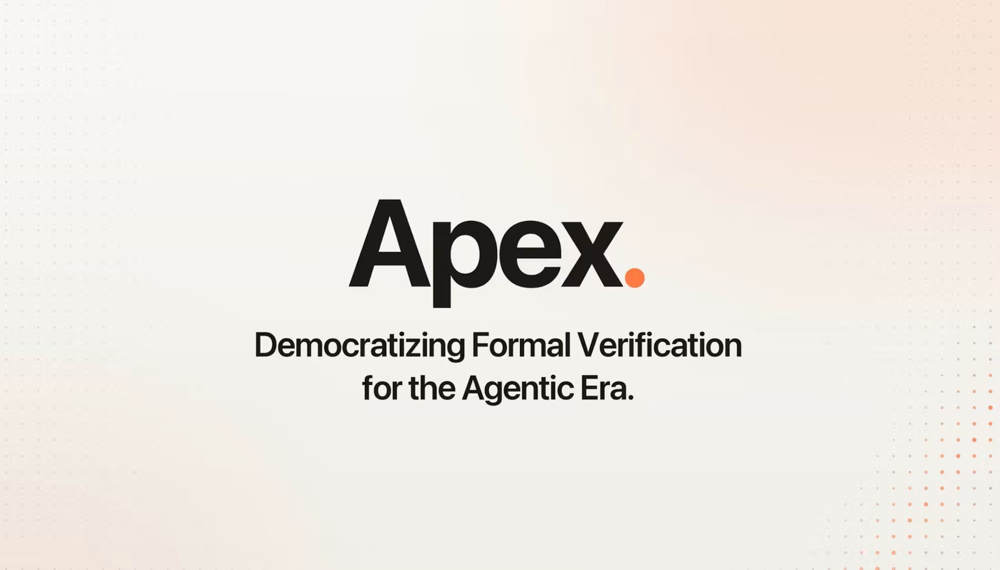

# Apex

<p align="center">
  
</p>

Apex checks Python, JavaScript and TypeScript functions against what they are supposed to do.
It uses three verification engines and gives one report:

| Engine | Question that it answers |
|---|---|
| **Lean 4** theorem prover | Is the property true for every input? |
| **TLA+** model checker (TLC) | Can a thread schedule break the property? |
| **Fuzzing and refutation** on the real code | Is there an input that breaks the property? |

You do not write a formal specification, and you do not need to know Lean, TLA+ or fuzzing.
Apex reads the intent that your project already has (English specs, docstrings and JSDoc,
tests, guards in the code), writes the theorems, and runs the engines. Your coding agent does
the model work: it formalizes English requirements and writes the proofs that Apex's tactics do
not find. A person approves what each statement means.

> **Status:** Research prototype. Python, JavaScript and TypeScript. MIT license. Not on PyPI.
> Start with the [quickstart](docs/QUICKSTART.md), and read [what Apex cannot prove](docs/LIMITS.md)
> before you rely on a verdict.

## Contents

- [Why Apex](#why-apex)
- [Verdicts and exit codes](#verdicts-and-exit-codes)
- [Installation](#installation)
- [Quick start](#quick-start)
- [Stating the intent](#stating-the-intent)
- [Using Apex from a coding agent](#using-apex-from-a-coding-agent)
- [Documentation](#documentation)
- [Development](#development)
- [License](#license)

## Why Apex

Coding agents write code faster than people can review it. Tests cover only the inputs their
author chose, and when the same model writes the code and its tests, both can share one mistake.
An agent saying the code "works" is not evidence.

Formal methods give stronger answers, but they usually need specialists. Apex lets models do
the repetitive work without letting them decide whether that work is correct:

| Role | Done by | Tasks |
|---|---|---|
| Propose | A coding agent, an AI model, or Apex heuristics | Formal statements from English, proofs, TLA+ specifications |
| Decide | Lean 4, TLC, and the real code | Check each proof and audit its axioms, model-check each spec, run the real code |
| Approve | A person | Confirm that each statement says what the code is meant to do |

A model can make Apex faster. It cannot produce a `proven` verdict: only a Lean proof of a
statement that a person approved can.

## Verdicts and exit codes

Each property gets one verdict, and each verdict states how strong it is:

| Verdict | Meaning | Exit |
|---|---|---|
| `proven` | Lean proved an approved statement for every input. | 0 |
| `refuted` | Apex ran the real code and saw it break the property. The report has the input. | 1 |
| `contradiction` | Two intent sources disagree (a docstring and a test, for example). | 1 |
| `fidelity_failed` | The model Apex checked (Lean or TLA+) does not match the real code. | 1 |
| `proven_unreviewed` | Proven, but no person approved the statement yet. | 2 |
| `proven_conditional` | Proven under an assumption the code does not state (JS `number` stays a safe integer). | 2 |
| `model_checked` | TLC found no violation within the bounds, and real runs match the spec. Evidence, not proof. | 2 |
| `fuzzed` | A recorded fuzzing campaign found no counterexample. Evidence, not proof. | 2 |
| `unproven` | No proof and no counterexample within the budget. The report says why. | 2 |
| `out_of_scope` | Apex cannot model this code (I/O, unsupported constructs). The report says why. | 2 |

A run exits with **0** when all approved properties are proven, **1** on any failure, **2** for
gaps only, and **3** on a tool error. A function with no intent counts as a gap, so a run that
checks nothing cannot pass. The `fail_on` setting can turn chosen gaps into failures.

## Installation

You need Python 3.12+, [uv](https://docs.astral.sh/uv/) and, for proofs,
[elan](https://github.com/leanprover/elan) (about 5 GB for the pinned Lean toolchain and
Mathlib, shared by all projects).

```sh
git clone https://github.com/hyperionaidev/apex && cd apex
uv build && uv tool install dist/apex_verify-*.whl
apex init            # writes apex.toml, installs the pinned Lean toolchain and Mathlib cache
apex doctor          # required items show "ok"; optional ones may show "warn"
```

Optional engines:

| For | Requirement |
|---|---|
| JavaScript and TypeScript | Node.js 22.6 or later (no npm packages) |
| TLA+ model checking | Java 11+, then `apex init --tla` |
| Coverage-guided JavaScript fuzzing | npm, then `apex init --js` (Jazzer.js) |
| Coverage-guided Python fuzzing | the `fuzz` extra (Atheris) and a clang with libFuzzer |
| Model-assisted steps | Claude Code or Codex with a login, or an API key |

Refutation and fuzzing work without Lean. On Windows, use WSL. The
[usage guide](docs/USAGE.md#installation-details) has the details and the
[configuration](docs/USAGE.md#configuration) keys.

## Quick start

```python
# shapes.py
def clamp(x: int, lo: int, hi: int) -> int:
    """Limit x to the range [lo, hi].

    pre: lo <= hi
    post: lo <= __return__ <= hi
    post: lo <= x <= hi -> __return__ == x

    >>> clamp(5, 0, 3)
    3
    """
    return max(lo, min(x, hi))
```

```sh
apex check shapes.py                              # P1, P2 and E1: proven_unreviewed, exit 2
apex review shapes.py::clamp                      # read the statements, in English and in Lean
apex review shapes.py::clamp --approve P1,P2,E1   # in your own terminal
apex check shapes.py                              # proven, exit 0
```

Change `min(x, hi)` to `min(x, hi - 1)` and check again: P2 and E1 become `refuted`, each with
an input. `apex explain` says what each verdict means, and `apex suggest` gives the fix and a
regression test. The [quickstart](docs/QUICKSTART.md) walks through this with real output.

## Stating the intent

Apex never takes the intent from the code itself: proving code against itself shows nothing.
It reads and combines these sources:

- **English specs:** a `<module>.spec.md` next to the module, one requirement per list item.
  A formal hint in backticks makes a requirement checkable; without one, the agent can
  formalize it, and a person approves the result.
- **Docstrings and JSDoc:** doctests, `@example`, `pre:`/`post:` and `@pre`/`@post`.
- **Tests:** pytest, Hypothesis, Jest, Vitest, node:assert and fast-check.
- **Guards:** leading `assert`s and `if (...) throw` become preconditions.

```markdown
## clamp
- Requires: the range is not empty. `lo <= hi`
- The result lies in [lo, hi]. `lo <= r <= hi`
- Values in the range are not changed. `lo <= x <= hi -> r == x`
```

When two sources disagree, Apex reports a `contradiction` and does not pick one. See
[stating the intent](docs/USAGE.md#how-to-state-the-intent) for the hint language.

## Using Apex from a coding agent

Apex assumes a coding agent is available. One command installs the `apex-verify`
[Agent Skill](skill/apex-verify/SKILL.md) and the `apex` MCP server for Claude Code, Codex,
Gemini CLI, Cursor and VS Code (Copilot):

```sh
apex skill install --with-mcp
```

Then ask the agent to verify a function. The agent runs Apex, reads the counterexamples, fixes
the code, and writes the proofs that Apex's tactics leave open, using the proof tasks and Lean
tools Apex gives it. It shows you the result table and asks you to approve the statements; no
tool can approve on your behalf.

From the command line, `apex check` uses the installed `claude` or `codex` CLI by default, then
an API key. Set `APEX_MODEL_PROVIDER=none` for a run without a model, for example in CI:

```yaml
- run: apex check src/ --sarif apex.sarif     # exit 1 fails the job; gaps (exit 2) do not
- uses: github/codeql-action/upload-sarif@v3
  if: always()
  with: { sarif_file: apex.sarif }
```

For existing app code (untyped functions, records, float money, dates), the agent writes an
`apex.profile.toml` with the project's types and value ranges, and owners record rulings on
counterexamples with `apex decide`. See
[existing projects](docs/USAGE.md#existing-projects-survey-profile-references-decisions).

## Documentation

| Document | Contents |
|---|---|
| [Quickstart](docs/QUICKSTART.md) | A first run, step by step, with real output |
| [Usage](docs/USAGE.md) | Intent and hints, every command, models and agents, app code, fuzzing, TLA+, JavaScript and TypeScript, CI, configuration |
| [Limits](docs/LIMITS.md) | What each verdict does and does not mean, and what Apex cannot model |
| [Architecture](docs/ARCHITECTURE.md) | The pipeline and engines, design principles, trust base, internals |
| [Evaluation](docs/EVALUATION.md) | The eval corpus and its current results |
| [Changelog](CHANGELOG.md) | What changed, phase by phase |
| [Agent Skill](skill/apex-verify/SKILL.md) | The procedure coding agents follow |

Current eval results: 171 of 171 cases as expected, 0 false `proven`, 0 false evidence, and 63
of 63 planted bugs found with a counterexample.

## Development

```sh
uv sync --all-extras && uv run apex init      # add `apex init --tla --js` for the TLA+ and Jazzer.js tests
uv run pytest -m "not lean and not install"   # unit tests (TLA+ and Jazzer.js tests skip without their tools)
uv run pytest -m lean                         # Lean canaries and end-to-end tests
uv run pytest -m install                      # builds the wheel and runs the installed binary
uv run python evals/run.py --jobs 4           # eval corpus and results
uv run python evals/smoke/run.py              # real agents run the skill (uses model credits)
uv run ruff check . && uv run pyright
```

The canary tests include proofs that try to cheat (`sorry`, `admit`, `native_decide`, a user
`axiom`, a forged audit line), and each asserts that the axiom audit alone rejects them.

```
src/apex/        the package (see docs/ARCHITECTURE.md)
lean/            the pinned Lake project: Lean 4.35.0, Mathlib 4.35.0, the Apex prelude
skill/           the apex-verify Agent Skill
packaging/       generated Claude Code plugin and Gemini CLI extension
evals/           eval corpus, runner, agent smoke tests
schemas/         JSON Schemas for all --json output
docs/            quickstart, usage, limits, architecture, evaluation
tests/           unit, Lean, installation, TLA+ and JavaScript tests; canaries
```

Record user-facing changes under **Unreleased** in the [changelog](CHANGELOG.md).

## License

Apex is released under the [MIT License](LICENSE).
