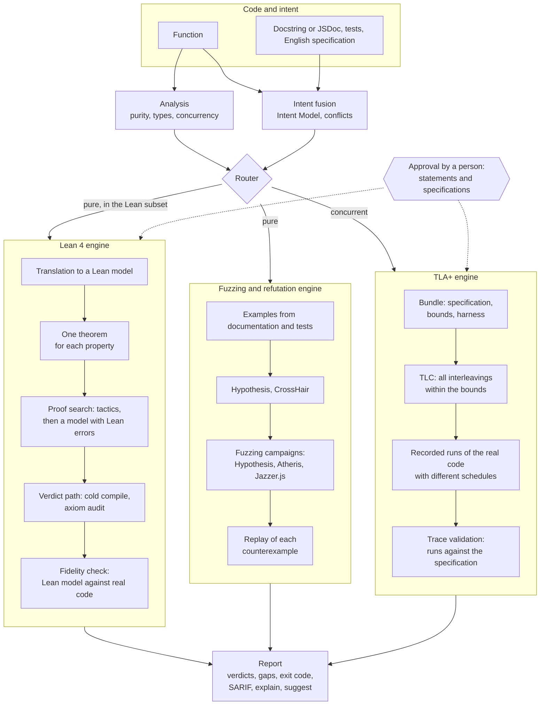

# Apex architecture

This page describes how Apex works: the pipeline and its three engines, the design rules, what
each verdict trusts, and then the internals that carry trust, in enough detail to review them.

## Contents

- [Overview](#overview)
- [Design principles](#design-principles)
- [Trust base](#trust-base)
- [One pipeline, three surfaces](#one-pipeline-three-surfaces)
- [The verdict path](#the-verdict-path)
- [Spec files are a trust boundary](#spec-files-are-a-trust-boundary)
- [Translation](#translation)
- [The JavaScript / TypeScript frontend](#the-javascript--typescript-frontend)
- [Intent: mining and fusion](#intent-mining-and-fusion)
- [Statements and approval](#statements-and-approval)
- [Proof search](#proof-search)
- [The fidelity bridge](#the-fidelity-bridge)
- [Refutation](#refutation)
- [Fuzzing campaigns](#fuzzing-campaigns)
- [TLA+ for concurrent code](#tla-for-concurrent-code)
- [Workspace layout](#workspace-layout)
- [Pinning and installation](#pinning-and-installation)

## Overview

Apex is one pipeline with three verification engines. The shared front end reads the code and
the intent. A router sends each function to the applicable engines. The shared back end makes
one report from the results of all engines.



**Shared front end**

1. **Analysis.** Apex finds the target and classifies it. The classes are pure or impure (I/O,
   global state, randomness, floats), concurrent or not, and in the Lean subset or not. Apex
   first converts a JavaScript or TypeScript function into the shared subset. The conversion
   keeps the JavaScript semantics (truncated `%`, safe-integer `number`).
2. **Intent fusion.** Apex reads the docstrings, tests, English specifications and leading
   assertions. It makes one Intent Model with stable property IDs (P1, P2 for properties, E1 for
   examples). It identifies conflicts between sources.
3. **Routing.** Apex sends each function to each applicable engine:

   | Function | Lean 4 | Fuzzing and refutation | TLA+ |
   |---|---|---|---|
   | Pure, in the subset | Proves | Also runs | Not applicable |
   | Pure, not in the subset | Not applicable | Refutes or fuzzes | Not applicable |
   | Concurrent | Not applicable | Not applicable | Model-checks |
   | Other impure code (I/O) | Not applicable | Not applicable | Not applicable: `out_of_scope`, with the pure core |

**Lean 4 engine** (the only source of `proven`)

4. **Translation.** Apex translates the function into a Lean model. The translator accepts a
   small subset of the language. It rejects each construct that it cannot model exactly.
5. **Statements.** Apex writes one Lean theorem for each formal property. The same translator
   translates the statements and the function. A person approves each statement.
6. **Proof search.** Apex tries deterministic tactic tiers first (`decide`, `omega`, `simp`,
   induction). Then an optional AI model tries, and gets the Lean errors and goal states.
7. **Verdict path.** Apex compiles the specification cold. It rejects prohibited constructs
   (`sorry`, `native_decide`, forged output). It audits the axioms against a fixed list.
8. **Fidelity check.** Apex runs the compiled Lean model and the real code on 200 generated
   inputs. A difference changes each proof of that function to `fidelity_failed`.

**Fuzzing and refutation engine** (search on the real code)

9. **Refutation.** During each check, Apex uses the examples, Hypothesis and CrossHair.
10. **Fuzzing.** On request (`apex fuzz`, `apex check --fuzz`), Apex runs a recorded campaign
    with Hypothesis, Atheris or Jazzer.js.
11. **Replay.** Apex runs each counterexample again on the real code before the verdict becomes
    `refuted`. A campaign without a counterexample gives `fuzzed`.

**TLA+ engine** (concurrent code)

12. **Specification.** The bundle contains the specification, the bounds, the invariants and a
    harness that runs the real code. An AI model can write a draft. A person approves it.
13. **Model checking.** TLC examines all interleavings that the specification permits, within
    the bounds.
14. **Trace validation.** Apex runs the real code many times with different thread schedules.
    TLC examines each recorded run against the specification. An invariant failure in a real run
    gives `refuted`. A run that the specification does not permit gives `fidelity_failed`.

**Shared back end**

15. **Report.** Apex gives one verdict for each property, with reason codes, next steps and the
    exit code of the run. The output formats are Rich, Markdown, JSON and SARIF. `apex explain`
    and `apex suggest` give explanations and changes.

The packages follow the same structure:

| Layer | Package | Contents |
|---|---|---|
| Contracts | `apex.core` | Verdicts, reason codes, Intent Model, report, configuration, JSON Schemas |
| Front end | `apex.analyze`, `apex.intent` | Analysis and routing data, intent mining and fusion |
| JavaScript front end | `apex.js` | tree-sitter parser, conversion to the shared subset, JSDoc, Jest and fast-check mining, Node.js bridge, Jazzer.js |
| Lean 4 engine | `apex.translate`, `apex.theorems`, `apex.prove`, `apex.lean` | Translation, statements and review, proof search, pinned Lean project, verdict path |
| Fuzzing and refutation engine | `apex.fidelity` | Refutation, fuzzing campaigns, fidelity bridge for the Lean engine |
| TLA+ engine | `apex.tla` | Bundles, pinned TLC, run recorder, trace validation, drafts |
| Models | `apex.llm` | Model providers: agent CLIs or API keys. Models only propose. |
| Interfaces | `apex.cli`, `apex.mcp`, `apex.skill`, `apex.report` | CLI, MCP server, Agent Skill installer, output formats |
| Orchestration | `apex.pipeline` | The deterministic commands that all interfaces call |

All interfaces (CLI, MCP, skill) call the same pipeline functions. Thus, their behavior is the
same. The sections after "Trust base" give the internal details of each engine.

## Design principles

1. **Result strength.** Each verdict states the strength of its result: all inputs, all
   interleavings within bounds, N executions, or one observed failure. No output combines or
   changes these strengths.
2. **Source of `proven`.** Only the Lean verdict path sets `proven`, `proven_unreviewed` or
   `proven_conditional`. Models, agents, fuzzing campaigns and TLC cannot set these verdicts.
   `model_checked` and `fuzzed` are gap verdicts and give exit code 2.
3. **Separation of proposal and decision.** All model output (hints, proofs, TLA+ bundles) goes
   through a deterministic check before it can change a verdict.
4. **Human approval of meaning.** A person approves each statement and each TLA+ bundle. Approval
   needs an interactive terminal (stdin and stdout are TTYs). An agent cannot approve its own
   work. A change to the function or to the statement makes the approval invalid.
5. **Model fidelity.** Each model is compared with the real code before Apex reports a result
   about it. The fidelity bridge compares the Lean models. Trace validation compares the TLA+
   specifications. If they do not agree, Apex discards the result.
6. **Observed failures.** `refuted` requires a run of the real code that shows the failure. A
   violation that occurs only in a model stays a gap.
7. **No approximation.** The translator rejects each construct that it cannot model exactly. The
   rejection gives a gap with a reason code and a line number.
8. **Gaps as output.** Each gap has a reason code and next steps. A run that examines no property
   cannot give exit code 0.
9. **Pinned tools.** Lean, Mathlib, TLC and Jazzer.js have pinned versions. TLC also has a pinned
   checksum. A version change is a separate change, and the eval corpus must pass again.

## Trust base

Each verdict depends on these items:

| Verdict | Depends on |
|---|---|
| `proven` | The Lean 4 kernel and the pinned Mathlib. The permitted axioms are only `propext`, `Classical.choice` and `Quot.sound`. The approved statement: Lean proves the statement as written. The translator: the proof is about the Lean model of the function. The fidelity check tests this model against the real code, but a test is not a proof. |
| `model_checked` | TLC. The approved bundle, especially the harness: its `observe()` function defines the shared state that Apex compares. The bounds in `Spec.cfg`. The recorded runs: they are a sample of the thread schedules, not all schedules. |
| `fuzzed` | The coverage of the campaign: an input that the campaign did not generate can break the property. The property hint: a hint that is always true does not find errors. |
| `refuted` | Only the language runtime: Apex ran the real code and observed the failure. You can run the counterexample again. |

All verdicts are partial-correctness results. The preconditions (leading `assert` statements,
`pre:` lines, "Requires:" items) limit each result. Outside the preconditions, the function has
no specified behavior.

## One pipeline, three surfaces

`apex.pipeline` holds the deterministic verbs: analyze, scaffold, prove, verify, refute, fuzz,
check, the TLA+ checks, and review status. The CLI (`apex.cli`), the MCP server (`apex.mcp`) and
the Agent Skill (`skill/apex-verify`, through the CLI or MCP) all call these functions, so the
surfaces cannot disagree. Every `--json` output is a pydantic model with a published JSON Schema
in `schemas/`. A test fails if a command has no schema, and CI fails if a schema drifts.

Two rules are enforced by what is *not* exposed:

- **No surface can approve a statement.** Approval is `apex review --approve`, and it requires an
  interactive terminal (stdin and stdout both TTYs), so an agent's shell cannot approve on a
  person's behalf. MCP has no approve tool at all.
- **Model steps run only in engine mode, and only with a configured provider.** In host mode
  the driving agent does the model work and the tools check it.

The MCP server serializes tool calls. Hypothesis is not thread-safe, and the TLA+ recorder sets
process-wide tracing and switch-interval state.

## The verdict path

`apex.lean.compiler.compile_and_audit(source, theorem_names)` is the only code that can report
that a theorem was proved. It:

1. **Screens the source** (`apex.lean.guard`) for what the axiom audit cannot see:
   - `set_option debug.skipKernelTC`;
   - metaprogramming that could forge output (`run_cmd`, `macro`, `#eval`, ...);
   - `#exit`;
   - imports outside the pinned libraries.
2. **Appends a footer** of `#print axioms` lines and compiles the file **cold**, in a clean temp
   directory.
3. **Reads the audit only from messages positioned inside that footer**, mapped by line, so
   nothing the submission prints can impersonate a clean audit.
4. **Marks a theorem proved only if all of these hold:**
   - Lean reported no errors anywhere;
   - the guard found nothing;
   - every axiom is in `propext`, `Classical.choice`, `Quot.sound`.

   Timeouts kill the whole process group.

The warm REPL pool (`apex.lean.repl`, via LeanInteract) speeds up proof search only and can never
produce a verdict.

The canary suite (`tests/canaries/`) includes proofs that cheat:

- `sorry` and `admit`;
- `native_decide`;
- a user `axiom`;
- a forged audit line.

Each one asserts that the **axiom audit alone** rejects it, so a guard that happens to fire first
cannot hide a regression in the real trust anchor.

Performance notes:

- **`lake env` startup** can cost far more than the compile itself (tens of seconds against
  ~0.4 s). The environment it resolves is cached in `lean/.lake/apex-lean-env.json`, keyed on the
  toolchain, manifest and lakefile, and `lean` is invoked directly.
- **The prelude** (`lean/Apex/Prelude.lean`) is core-only, because every verdict is a cold
  compile and whatever it imports is paid each time. Generated files import only the Mathlib
  modules a proof needs.

## Spec files are a trust boundary

A person approves statement text, so nothing else in a spec may change what that text means.

- **What a spec may contain.** Only imports and `theorem`/`lemma` declarations. No `def`,
  `instance`, `notation`, `attribute` or `set_option`, except a per-theorem heartbeat cap.
- **Implicit variables are off.** The verdict file always sets `autoImplicit false`, so a typo in
  a statement is an error rather than a silently universally quantified variable.
- **Hashes.** `apex.theorems.spec` parses declarations and hashes each statement. Approval is
  keyed by (function hash, property ID, statement hash), so an edit to either the function or
  the statement voids it.

## Translation

`apex.translate.lean` turns a function, and the module functions it calls, into a Lean model.

| Supported | Not supported |
|---|---|
| ints (Python's floor `//` and `%`) and bools | `str`, `float`, `dict`, `set`, classes |
| lists, fixed tuples, `Optional` returns | indexing |
| `if` / `elif` / `else`, conditional expressions | `while` |
| `for` over lists and `range` (rewritten as `foldl`) | `return`, `break` or `continue` inside a loop |
| list comprehensions, slices with literal bounds | exceptions |
| `len`, `abs`, `sum`, two-argument `min`/`max`, `any` | globals, nested functions |

Anything else raises a `TranslationError` with a reason code and the line, which the report
shows as a gap. Lean reserved words used as Python names (`repeat`, `using`, ...) are escaped as
`«name»`. The list was checked by compiling `def <name>` for every Python keyword, builtin and
common identifier, with and without Mathlib.

Leading `assert`s are preconditions, not code. The model leaves them out, and drafted statements
assume them (partial correctness).

## The JavaScript / TypeScript frontend

`apex.js` gives JS and TS the same pipeline and the same trust story:

1. **Parse** (`apex.js.parse`). tree-sitter's TypeScript grammar, which also reads plain JS,
   finds the top-level functions (declarations and `const f = (...) =>`), their export status
   (ESM and CommonJS), their JSDoc, and their types (TypeScript annotations or JSDoc
   `@param {T}`).
2. **Lower** (`apex.js.lower`). Each function becomes a function in the Python subset AST, with
   JavaScript's meaning made explicit:
   - `%` becomes `__apex_tmod__` (Lean `Int.tmod`);
   - `Math.floor(a / b)` becomes floor division, and `Math.trunc(a / b)` becomes
     `__apex_tdiv__` (`Int.tdiv`);
   - `reduce` becomes `__apex_reduce__` (`List.foldl`), and `map`, `filter`, `some`, `every`,
     spread and `slice` become their subset forms.

   Impure APIs lower onto constructs the purity classifier already rejects (`console` to
   `print`, `Math.random` to `random`, `Date` to `time`, `fs` / `process` / `fetch` to `os`,
   timers and `async` to concurrency). Anything else becomes
   `__apex_unsupported__("what", "REASON")`, which carries its operands so purity still sees
   inside it. The translator turns that marker into a gap with the JS line.
3. **Translate.** The translator, statement drafting, proof search and verdict path are the
   shared ones. The translator refuses `===` on arrays in lowered JS (identity in JavaScript).
4. **Execute** (`apex.js.runner`). A Node worker (`runner.mjs`, no npm packages; TypeScript runs
   through Node's type stripping) imports the module and answers JSON-line calls. A Python proxy
   makes each exported function a callable, so refutation, fuzzing and the fidelity bridge run
   unchanged against the real JS:
   - `bigint` and `number` are encoded faithfully;
   - a mutated argument is mirrored back into Python;
   - a thrown error is `JsError`, and a stack overflow is `RecursionError`;
   - a `number` result outside the safe-integer range is skipped as outside the assumption;
   - a call over budget kills and restarts the worker.
5. **Verdicts.** A Lean proof of code on `number` becomes `proven_conditional`, with the added
   precondition that every intermediate value is a safe integer. `bigint` code can be `proven`.
6. **Intent** (`apex.js.intent`). Sources are JSDoc `@pre` / `@post` / `@example`, Jest and
   Vitest `expect(...)`, node:assert, and fast-check properties.
   - A fast-check call's arguments bind to the function's parameters: a literal argument becomes
     a premise (`lo === 0`), so the property is not overgeneralized.
   - JS-syntax hints (`result`, `==>`) are lowered by the same code as the function, so `%` in a
     hint means what it means in the code.
7. **Jazzer.js** (`apex.js.jazzer`). Coverage-guided fuzzing runs in Node. The property is
   emitted back to JavaScript (deep, bigint-aware equality) so it is checked inside the fuzz
   loop. Every reported input is replayed in Python through the proxy before it counts.

## Intent: mining and fusion

Each intent source has a miner in `apex.intent`:

| Miner | Reads |
|---|---|
| `docstring` | doctests, `pre:` / `post:` |
| `tests` | literal asserts and `parametrize` rows; Hypothesis `@given` bodies, with strategy bounds and `assume` as premises |
| `english` | `.spec.md` list items, with optional backticked hints |
| `source` | leading `assert`s |

`apex.intent.fuse` merges them:

- **Merging.** Canonically equal hints merge into one property that keeps every source.
- **Stable IDs.** IDs stay the same across runs as long as a hint is unchanged, so approvals
  and theorem names keep pointing at the same claim.
- **Conflicts.**
  - Two examples with the same input and different outputs conflict.
  - An example conflicts with a property when the property's hint, evaluated on the example,
    is false.
  - A hint that calls a module function is never checked this way: evaluating it would run the
    code under test, so a bug would pass for disagreeing sources.
  - Conflicted properties are `contradiction` and are not checked against the code.

Formal hints use an allowlisted Python subset, parsed before anything evaluates them
(`apex.intent.hints`). The same hint is evaluated on the real Python (for conflicts and
refutation) and translated by the function's translator into the Lean statement.

## Statements and approval

`apex.theorems.draft` builds one Lean theorem per formal hint.

- **Shape.** The parameters are binders, preconditions and premises become hypotheses, and the
  conclusion has the result replaced by the model's call.
- **Which preconditions.** A precondition is included only when the claim mentions everything
  it constrains.
- **Examples.** These become closed theorems such as `clamp 5 0 3 = 3`.
- **Review store.** Statements live in `Spec.lean` and approvals in `.apex/reviews.json`.
  `apex review` shows each statement in English and in Lean. TLA+ invariants are reviewed the
  same way, and approving one approves its whole bundle.

## Proof search

**Tactic tiers** (`apex.prove.tactics`) try fixed, cheap tactics in one Lean run:

- `decide`;
- `omega`;
- `simp` with the model's definitions;
- splitting `if`s;
- structural induction over list arguments.

**The model fixer loop** (`apex.prove.llm`) handles theorems the tiers leave open. The model
sees the prelude, the Lean model, existing lemmas, the statement and the tactics that already
failed, and it returns a proof, helper lemmas named `<ID>_...`, and imports. The answer is
refused before Lean runs unless:

- the spec rebuilds with every existing statement byte-for-byte unchanged;
- only those lemmas were added;
- no forbidden token appears.

A candidate is compiled, and Lean's errors and goal states go back for up to `retries` more
attempts. A proof that compiles is written into the spec and judged by the verdict path like any
other. Theorems the real Python already refutes are never sent to a model. Who proposed each
proof is recorded in the report's provenance, for debugging only.

## The fidelity bridge

A proof is about the Lean model, so `apex.fidelity.bridge` checks the model against the real
function before any proof is reported:

1. Generate 200 inputs. Integers mix small, medium and large ranges.
2. Keep only the inputs that satisfy the preconditions. Outside them the function promises
   nothing (Python may raise where Lean's total model returns a value).
3. Run the Python on them, smallest first. An input that hits the recursion limit, or needs more
   than 20 ms in CPython, is skipped and counted. Lean's interpreter is much slower on big lists.
4. Evaluate the compiled Lean model on the kept inputs with `#eval`.
5. Any disagreement, a Python exception, or argument mutation turns every proof of that function
   into `fidelity_failed`.

## Refutation

`apex.fidelity.refute` searches the real Python, cheapest search first:

1. the mined examples;
2. Hypothesis (300 inputs, filtered by preconditions and premises);
3. CrossHair, symbolic execution in a subprocess under a time budget.

Every input any search reports is **replayed in-process by the same evaluator** before it
becomes a counterexample, so `refuted` always means "Apex watched it happen".

Resource limits are skipped, never reported:

- A per-call budget (0.5 s, enforced with a per-thread trace function so it works off the main
  thread) catches loops over huge ranges.
- `RecursionError` is a resource limit like memory, and depends on the caller's stack depth.
- After three slow calls a search stops calling the function.

## Fuzzing campaigns

`apex.fidelity.fuzz` runs a time-budgeted campaign per property and reuses refutation's checks:
the same preconditions, skips and replay.

- **Hypothesis engine.** Seeded batches of 500 inputs until the budget runs out; failures are
  shrunk.
- **Atheris engine.** A subprocess (`python -m apex.fidelity.fuzz`), because libFuzzer exits the
  process when it is done.
  - The function, its module's helpers, the harness and the precondition check are
    instrumented. libFuzzer quits when its first, empty input covers nothing, and that input
    often fails a precondition.
  - Values come from libFuzzer's bytes with the same small/medium/large integer mix.
  - Any input it reports is replayed in the parent.

Evidence is stored in `.apex/fuzz/<module>/<function>/evidence.json`, keyed by the function's
hash and the property's hint text. `verify` uses it only while both still match:

- a clean campaign turns `unproven` or `out_of_scope` into `fuzzed`;
- a recorded counterexample is replayed again and becomes `refuted`.

## TLA+ for concurrent code

`apex.tla` checks concurrent code against a per-function bundle in `.apex/tla/<module>/<function>/`:

| File | Contract |
|---|---|
| `Spec.tla` | module `Spec` with `Init`, `Next`, `Spec`; PlusCal is translated on a copy |
| `Spec.cfg` | `SPECIFICATION Spec`, `CONSTANTS` (the bounds), `INVARIANT(S)`, each becoming `T_<Name>` |
| `harness.py` | `setup()`, `run(state)` (calls the real code), `observe(state)`, optional `check_<Name>(obs, done)` |

`apex tla check` runs four steps:

1. **Model check.**
   - It runs TLC once per invariant, without `-continue`, because TLC's first counterexample per
     invariant is a shortest one.
   - Success is never read from TLC's summary line. With `-continue`, TLC prints "No error has
     been found" even after reporting violations.
   - Each TLC, SANY or PlusCal run gets its own `java.io.tmpdir`. Parallel runs sharing the
     system one delete each other's unpacked standard modules.
2. **Record.**
   - It runs the harness 200 times with a tiny thread switch interval and random short sleeps at
     line events.
   - A trace function in every thread the run starts snapshots `observe(state)` after each line
     executed in the code's own files, compared by real path (macOS temp directories go through
     a symlink). It keeps a snapshot whenever the observed state changes.
   - Cached modules that would shadow the code under test are dropped first, so a long-lived
     process never checks stale code.
3. **Validate traces.** For each distinct trace, TLC gets a module `ApexTrace` that extends
   `Spec` with a counter `tl`.
   - `Next` steps that leave every observed variable unchanged are allowed, because the recording
     cannot see them.
   - Other steps must match the next recorded state.
   - If TLC can reach the end of the trace (reported as a violation of `TraceUnfinished`), the
     run is a behavior of the spec. If it cannot, the spec does not describe the code.
4. **Observe violations.** `check_<Name>(obs, done)` is evaluated on every recorded observation,
   so an invariant can be watched breaking in the real code.

Verdict precedence per invariant:

1. observed breaking in a real run: `refuted`;
2. a rejected trace: `fidelity_failed`;
3. TLC or conformance could not complete: `unproven` (`MODEL_CHECK_FAILED`);
4. a TLC violation no run showed: `unproven` (`SPEC_VIOLATION_NOT_REPRODUCED`, with TLC's trace);
5. otherwise: `model_checked`.

A check that cannot complete is never `model_checked`. Results are keyed by the bundle hash and
the function hash.

`apex tla draft` asks a model for a bundle. The draft is validated by structure, the PlusCal
translation and a SANY parse, with errors fed back for up to three attempts. It is written
pending review.

## Workspace layout

```
apex.toml                         configuration (optional)
.apex/
  reviews.json                    approvals (commit this)
  last_report.json                the last verify/check report
  intent/<mod>/<fn>/              fused Intent Model, proposals, proof provenance
  lean/<mod>/<fn>/Model.lean      generated model (regenerated every run; do not edit)
  lean/<mod>/<fn>/Spec.lean       statements and proofs (yours to edit; parsed as a trust boundary)
  fuzz/<mod>/<fn>/evidence.json   the latest fuzzing campaign per property
  tla/<mod>/<fn>/                 Spec.tla, Spec.cfg, harness.py, evidence.json
```

## Pinning and installation

These are pinned:

- Lean (`lean/lean-toolchain`);
- Mathlib (`lean/lake-manifest.json`, `v4.35.0`);
- TLC (`apex.tla.tlc`: v1.7.4, SHA-256 checked on install and on every use).

The wheel ships the Lean project as a template. `apex init` copies it to `~/.apex/lean/<pin>`
and fetches the toolchain and Mathlib cache there, outside the package, so every project and
every Apex upgrade shares them. Upgrading a pin is a deliberate change, re-run against the eval
corpus.
