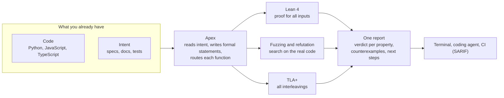
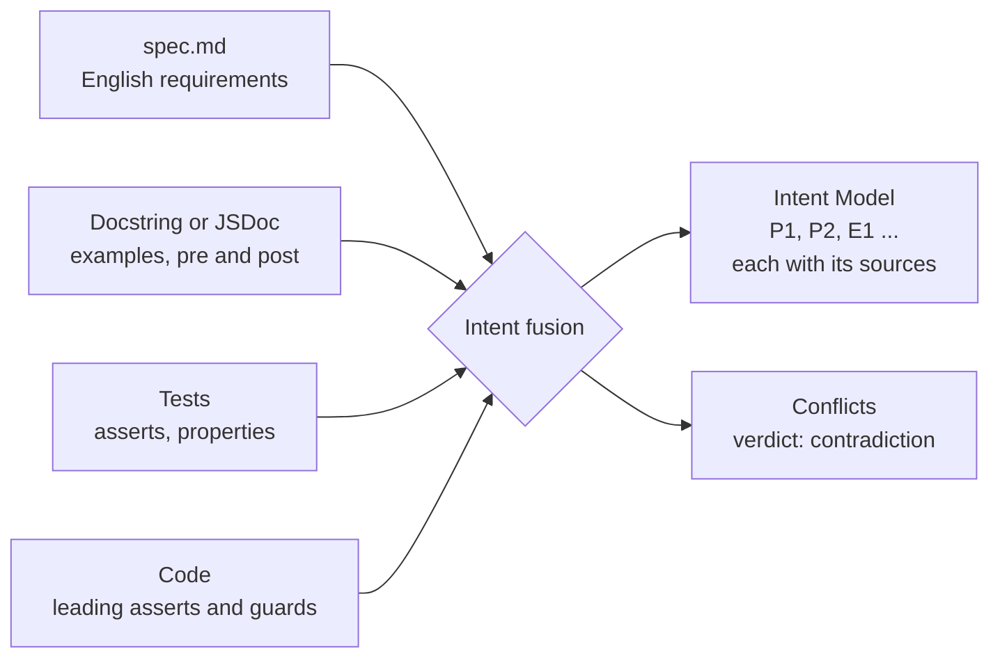
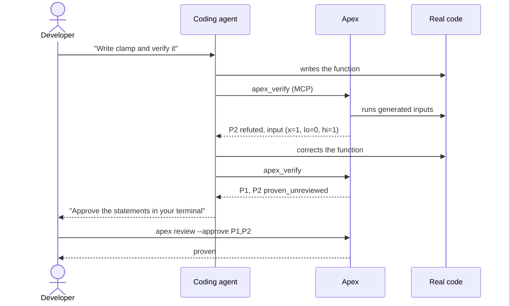
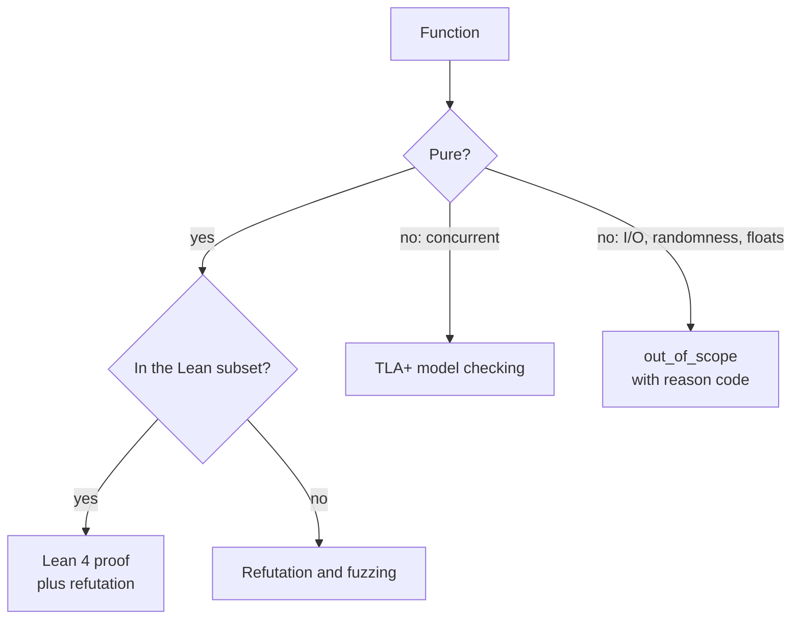
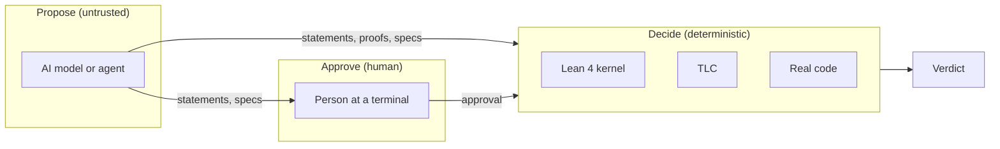

<!--
Website content for Apex: one landing page.

Notes for the web team:
- Each "## " heading is one page section, in the order shown.
- Diagrams are given twice: as Mermaid source (renders on GitHub, Docusaurus, Astro, MkDocs and
  others) and as a plain description, for a designer who redraws them.
- Code and terminal output are from real runs (docs/QUICKSTART.md), shortened.
- No figure on this page is an estimate except where it says "approximately".

Page title (HTML <title>): Apex: formal verification for AI-written code
Meta description: Apex verifies Python, JavaScript and TypeScript functions with Lean 4 proofs,
TLA+ model checking and fuzzing. It works from your existing docs, specs and tests, and it runs
inside your coding agent.
-->

# Apex

## Democratizing Formal Verification for the Agentic Era

Apex checks that a function does what its documentation, specification and tests say it does.
It proves the property for all inputs when it can. It finds a failing input when the property is
false. It tells you exactly which result you have, and which result you do not have.

Apex works with Python, JavaScript and TypeScript. It runs from the command line, in CI, and
inside coding agents such as Claude Code and Codex.

**[Get started](#get-started)** · **[View on GitHub](https://github.com/hyperionaidev/apex)**

```
$ apex check shapes.py
│ shapes.clamp │ P1 │ proven_unreviewed │ ...
│ shapes.clamp │ P2 │ refuted           │ input (x=1, lo=0, hi=1): lo <= x <= hi -> r == x; returns 0 │
│ shapes.clamp │ E1 │ refuted           │ input (x=5, lo=0, hi=3): 3; returns 2 │
```

---

## The problem

Coding agents now write a large part of new code. An agent writes a function in seconds and
hundreds of functions in a day. Writing code is no longer the slow step. Knowing that the code is
correct is the slow step.

The usual controls do not scale to this volume:

| Control | Why it is not sufficient |
|---|---|
| Code review | People cannot read code as fast as agents write it. Generated code usually looks correct, so an off-by-one error is easy to miss. |
| Tests | A test suite examines only the inputs that its author selected. Many errors occur at other inputs: an empty list, a negative number, a boundary value. |
| Self-verification | Frequently the same model writes the code and its tests. Then the tests and the code can contain the same error. |
| Agent statements | An agent that says "the code works" gives no evidence. It gives more generated text. |

Formal methods give stronger results. Theorem proving shows that code is correct for all inputs.
Model checking examines all interleavings of concurrent code. Systematic fuzzing runs very large
numbers of inputs to find a failure. These methods protect kernels, compilers and cryptographic
libraries. They are rarely used on ordinary code, because each method needs specialists and much
time.

AI makes formal methods more necessary, because there is more code than people can review. AI
also makes formal methods easier, because a model can do the repetitive work. But a model must
not decide if its own work is correct. Apex is built on that separation.

---

## What Apex does

Apex combines three verification engines in one tool and one report. You do not need to know
any of them.

| Engine | What it does | Question it answers |
|---|---|---|
| **Lean 4 theorem prover** | Proves a property for all inputs. | Is the property true for every input? |
| **TLA+ model checker (TLC)** | Examines all thread interleavings of a concurrent function, within set bounds. | Can a thread schedule break the property? |
| **Fuzzing and refutation** | Runs the real code with generated, coverage-guided and symbolic inputs. | Is there an input that breaks the property? |

Apex reads the intent, writes the formal statements, sends each function to the engines that
apply to it, and runs the real code to confirm every failure. A person approves each formal
statement once. After that, CI reproduces the results without a person.

### Diagram 1: Overview



**Description for a designer.** Left to right, four stages. Stage 1 is two input cards stacked
vertically: "Code" and "Intent (specs, docs, tests)". Both point to stage 2, one central "Apex"
block. Stage 2 fans out to three engine blocks in stage 3, stacked vertically, each with a short
caption: "Lean 4: proof for all inputs", "Fuzzing: search on the real code", "TLA+: all
interleavings". The three engines join into stage 4, one "Report" block, with three small
destination labels under it: terminal, coding agent, CI.

---

## It works from what you already wrote

Apex does not get the intent from the code. A proof of the code against itself shows nothing. It
also does not ask you to learn a specification language. It reads the intent that your project
already contains:

| Source | Python | JavaScript and TypeScript |
|---|---|---|
| **Specifications in English** | `<module>.spec.md`, one requirement for each list item | The same |
| **Documentation in the code** | Docstrings: doctests, `pre:` and `post:` lines | JSDoc: `@example`, `@pre`, `@post` |
| **Tests** | pytest asserts, `parametrize` rows, Hypothesis `@given` | Jest, Vitest, node:assert, fast-check properties |
| **The code itself** | Leading `assert` statements become preconditions | Leading `if (...) throw` guards and `assert(...)` calls |

Apex combines all sources into one Intent Model. Each property has a stable ID (P1, P2 for
properties, E1 for examples) and a link to every source that states it.

When two sources disagree, Apex does not choose one. Both properties get the verdict
`contradiction`, and a person decides which source is correct. Example: the docstring says
`f(2) == 6` and a test says `f(2) == 5`.

An English specification needs no formal syntax. A short formal hint in backticks makes a
requirement checkable. An AI model can write the hint for you; a person approves it.

```markdown
## clamp
- Requires: the range is not empty. `lo <= hi`
- The result lies in [lo, hi]. `lo <= r <= hi`
- Values in the range are not changed. `lo <= x <= hi -> r == x`
- It is fast.            <- no hint: stays as text, reported as SPEC_AMBIGUOUS
```

### Diagram 2: Intent fusion



**Description for a designer.** Four source cards on the left (spec, docs, tests, code) with
arrows into one merge node. The merge node has two outputs: a large "Intent Model" card that
lists property IDs P1, P2, E1, and a small warning card "Conflicts", drawn in the failure color.

---

## It runs inside your coding agent

Apex is designed for the agent loop. One command installs the `apex-verify` Agent Skill and the
`apex` MCP server:

```sh
apex skill install --with-mcp
```

| Harness | Skill | MCP server |
|---|---|---|
| Claude Code | Yes | Yes |
| Codex | Yes | Yes |
| Gemini CLI | Yes | Yes |
| Cursor | Yes | Yes |
| VS Code (Copilot) | Yes | Yes |

The command adds entries to each tool's configuration and does not overwrite existing entries.

After installation, ask the agent in your own words to verify a function. The agent runs Apex,
shows the Apex result table without change, and uses each counterexample to correct the code.
The MCP server supplies the deterministic steps as typed tools, for example `apex_verify`,
`apex_refute`, `apex_fuzz` and `apex_tla_check`. When a proof fails, the agent gets the Lean
errors, the line to edit and the goal state.

The full cycle is tested end to end with Claude Code and Codex: write the code, fail
verification, read the counterexample, correct the code, pass.

**The agent cannot approve its own work.** Approval of a formal statement needs an interactive
terminal. A coding agent's shell does not have one. A person always confirms that the statement
says what was intended.

### Diagram 3: The agent loop



**Description for a designer.** A sequence with four lanes: Developer, Coding agent, Apex, Real
code. Show the loop "write, verify, counterexample, correct, verify" between the agent, Apex and
the code as a circular arrow. At the end, a separate arrow from the Developer straight to Apex,
labeled "approve (terminal only)", to show that approval does not go through the agent.

---

## Three engines, one router

Apex classifies each function and sends it to every engine that applies.

| Function | Lean 4 | Fuzzing and refutation | TLA+ |
|---|---|---|---|
| Pure, in the Lean subset | Proves | Also runs | Not applicable |
| Pure, outside the Lean subset | Not applicable | Refutes and fuzzes | Not applicable |
| Concurrent (threads, locks, shared state) | Not applicable | Not applicable | Model-checks |
| I/O and other impure code | Not applicable | Not applicable | Not applicable: reported as `out_of_scope` with the reason |

### Lean 4: proof for all inputs

Apex translates the function into a Lean model and writes one theorem for each property. It
tries deterministic tactics first (`decide`, `omega`, `simp`, induction). An optional AI model
then tries the remaining goals and gets the Lean errors and goal states. Every proof goes through
the same verdict path: a cold compile, rejection of prohibited constructs (`sorry`,
`native_decide`, forged output), and an audit of the axioms against a fixed list.

Before Apex reports a proof, it runs the compiled Lean model and the real code on 200 generated
inputs. If they disagree, every proof about that function becomes `fidelity_failed`.

### Fuzzing and refutation: search on the real code

Every check searches for a counterexample with the documented examples, Hypothesis
property-based search and CrossHair symbolic execution. A fuzzing campaign runs for longer and
records its results, with Hypothesis, Atheris (coverage-guided, libFuzzer) or Jazzer.js. Apex
replays each counterexample on the real code before it reports `refuted`. A campaign with no
counterexample gives `fuzzed`, with the engine and the number of executions.

### TLA+: all interleavings of concurrent code

Lean cannot examine thread schedules. TLA+ can. A concurrent function gets a specification, the
bounds, the invariants and a harness that runs the real code. An AI model can write a draft; a
person approves it. TLC examines every interleaving that the specification permits. Then Apex runs
the real code many times with different schedules and checks each recorded run against the
specification. A real run that breaks an invariant gives `refuted`. A real run that the
specification does not permit gives `fidelity_failed`.

### Diagram 4: Routing



**Description for a designer.** A decision tree, top to bottom. First question "Pure?". The "yes"
branch asks "In the Lean subset?" and ends in "Lean 4" or "Fuzzing". The "no" branch splits into
"Concurrent: TLA+" and "I/O: out of scope". Color each end node with its engine color, the same
colors as in Diagram 1.

---

## Every result says how strong it is

Apex never rounds a result up. Each verdict states what was shown and how.

| Strength | Verdict | Source |
|---|---|---|
| True for all inputs | `proven` | Lean 4, for a statement that a person approved |
| True for all interleavings within the bounds | `model_checked` | TLC, and the recorded runs agree with the specification |
| No counterexample in N executions | `fuzzed` | A fuzzing campaign on the real code |
| Failure observed | `refuted` | Any engine, after Apex ran the real code and saw the failure |

All verdicts:

| Verdict | Meaning | Exit code |
|---|---|---|
| `proven` | Lean proved an approved statement with the standard axioms only, and the Lean model agreed with the real code. | 0 |
| `refuted` | An input or a recorded run makes the real code break the property. | 1 |
| `contradiction` | Two intent sources disagree. | 1 |
| `fidelity_failed` | The Lean model or TLA+ specification does not agree with the real code. | 1 |
| `proven_unreviewed` | Lean proved the statement, but no person approved it yet. | 2 |
| `proven_conditional` | Lean proved the statement under an assumption the code does not state. | 2 |
| `unproven` | No proof and no counterexample within the budget. A reason code says why. | 2 |
| `out_of_scope` | Apex cannot model the code exactly. A reason code says why. | 2 |
| `fuzzed` | No counterexample in a recorded campaign. Evidence, not proof. | 2 |
| `model_checked` | No violation within the bounds, and the real runs agree. Evidence, not proof. | 2 |

Exit code 0 means every approved property is proven. Exit code 1 means at least one failure.
Exit code 2 means gaps only. Exit code 3 means a tool error. A function with no stated intent is
a gap, so a run that examines nothing cannot pass.

### Diagram 5: Strength ladder

**Description for a designer.** A vertical ladder or bar with four steps, strongest at the top:
"proven: all inputs", "model_checked: all interleavings within bounds", "fuzzed: N executions
without failure", and at the side, separate from the ladder, "refuted: failure observed" in the
failure color. Draw a clear line between "proven" and the two steps below it, labeled "proof"
above the line and "evidence" below it.

---

## Built so that AI cannot fake a result

Apex divides the work into three roles. No single role controls the result.

| Role | Done by | Tasks |
|---|---|---|
| **Propose** | An AI model, a coding agent, or Apex heuristics | Write formal statements from English. Write proofs. Write TLA+ specifications. |
| **Decide** | Lean 4, TLC and the real code | Compile and audit each proof. Model-check each specification. Run the real code to confirm or refute. |
| **Approve** | A person | Confirm that each statement says what the code is meant to do. |

The rules that follow from this design:

1. **Only Lean sets `proven`.** Models, agents, fuzzing campaigns and TLC cannot set it.
   `fuzzed` and `model_checked` are gap verdicts and give exit code 2.
2. **Model output is a proposal.** Hints, proofs and TLA+ bundles from a model go through a
   deterministic check before they can change a verdict.
3. **A person approves meaning.** Approval needs an interactive terminal. A change to the
   function or to the statement makes the approval invalid.
4. **Models are checked against the real code.** The Lean model and the TLA+ specification are
   compared with the real code before Apex reports a result about them.
5. **Failures are observed.** `refuted` requires a run of the real code that shows the failure.
   A violation that occurs only in a model stays a gap.
6. **No approximation.** The translator rejects each construct that it cannot model exactly,
   with a reason code and a line number.
7. **Pinned tools.** Lean, Mathlib, TLC and Jazzer.js have pinned versions. TLC also has a
   pinned checksum.

### Diagram 6: Propose, decide, approve



**Description for a designer.** Three columns: "Propose" (a model icon, labeled untrusted),
"Decide" (three small blocks: Lean 4, TLC, real code), "Approve" (a person icon). Arrows from
Propose go to both Decide and Approve. Only Decide has an arrow to the final "Verdict". The point
of the image: the model never has a direct path to the verdict.

---

## See it work

**1. Write the function and its intent.** Here the intent is in the docstring.

```python
# shapes.py
def clamp(x: int, lo: int, hi: int) -> int:
    """Limit x to the range [lo, hi].

    pre: lo <= hi
    post: lo <= __return__ <= hi
    post: lo <= x <= hi -> __return__ == x

    >>> clamp(5, 0, 3)
    3
    """
    return max(lo, min(x, hi))
```

**2. Check it.** Lean proves all three properties. The compiled model agrees with the real
Python on 200 generated inputs. The verdict is `proven_unreviewed`, because no person has read
the statements yet.

```
$ apex check shapes.py
│ shapes.clamp │ P1 │ proven_unreviewed │ statement pending: run `apex review shapes.py::clamp --approve P1` │
│ shapes.clamp │ P2 │ proven_unreviewed │ ...
│ shapes.clamp │ E1 │ proven_unreviewed │ ...
  fidelity shapes.clamp: Lean model agrees with Python on 200 generated inputs
```

**3. Approve the statements** in your terminal. Each statement is shown in English and in Lean.

```sh
apex review shapes.py::clamp --approve P1,P2,E1
apex check shapes.py          # proven, exit 0
```

**4. Introduce an error.** Change `min(x, hi)` to `min(x, hi - 1)`:

```
│ shapes.clamp │ P1 │ proven_unreviewed │ ...
│ shapes.clamp │ P2 │ refuted           │ input (x=1, lo=0, hi=1): lo <= x <= hi -> r == x; returns 0 │
│ shapes.clamp │ E1 │ refuted           │ input (x=5, lo=0, hi=3): 3; returns 2 │
```

P1 stays true, because the result is still in the range. P2 and the example fail, each with an
input that Apex replayed on the real code. The approval of P1 became invalid because the function
changed. `apex suggest` turns each counterexample into a regression test:

```python
def test_clamp_P2_apex_counterexample() -> None:
    # Found by hypothesis; property P2: lo <= x <= hi -> r == x
    x = 1
    lo = 0
    hi = 1
    r = clamp(x, lo, hi)
    assert (not (lo <= x <= hi)) or (r == x)
```

**5. Concurrent code.** An unlocked read-modify-write in a worker thread:

```
$ apex tla check workers.py::racy_worker
  100 runs, 4 distinct traces checked by TLC
  T_NoLostUpdate  broke in run 20: reached count = 2 after 5 observed states
  T_NeverAhead  no violation in 201 states; runs conform
```

`T_NoLostUpdate` is `refuted`: TLC found the lost update in the specification, and a real run
showed it. `T_NeverAhead` is `model_checked`.

---

## Python, JavaScript and TypeScript

The same engines, statements, approval, reports and exit codes apply to all three languages.

```ts
/**
 * Limit x to the range [lo, hi].
 * @pre lo <= hi
 * @post lo <= result && result <= hi
 * @example clamp(5, 0, 3) // => 3
 */
export function clamp(x: number, lo: number, hi: number): number {
  return Math.max(lo, Math.min(x, hi));
}
```

- Apex parses JavaScript and TypeScript with tree-sitter and converts each function into the
  same subset that the Python translator uses. The proofs are Lean proofs.
- Refutation, fuzzing and the fidelity check run the real JavaScript in Node.js.
- A JavaScript `number` is a 64-bit float. Integer arithmetic on it is exact only up to
  2⁵³ − 1, so a proof about `number` code is `proven_conditional`: valid while every
  intermediate value is a safe integer. The same proof on `bigint` is fully `proven`.
- Apex keeps JavaScript semantics: `%` truncates toward zero, and `===` on arrays compares
  references.
- Coverage-guided JavaScript fuzzing uses Jazzer.js.

---

## In CI

```yaml
- run: apex check src/ --sarif apex.sarif   # exit 1 stops the job; gaps (exit 2) do not, unless fail_on says so
- uses: github/codeql-action/upload-sarif@v3
  if: always()
  with: { sarif_file: apex.sarif }
```

Results appear as code-scanning alerts. The verdict is the rule ID. Approvals are kept in
`.apex/reviews.json`; commit the file, and CI gives the same `proven` verdicts without a person.

---

## Measured results

The eval corpus is the acceptance test for every release: 171 cases, 126 in Python and 45 in
JavaScript and TypeScript. It contains correct functions, planted errors, specification and code
conflicts, out-of-scope code, functions written by Claude Code and Codex without changes, and
concurrent functions with TLA+ bundles.

| Measure | Result |
|---|---|
| False `proven` | **0** (required: 0) |
| False evidence (`fuzzed` or `model_checked` on a property that must fail) | **0** (required: 0) |
| Cases with the expected verdicts | 171 of 171 |
| Planted errors found with a counterexample | 63 of 63 |
| Conflicts between intent sources found | 22 of 22 |
| Out-of-scope functions with the correct reason | 24 of 24 |
| True properties proven, tactics only, no AI model | 168 of 294 |
| Median time for each function | 8.7 s |

With an AI model in the proof search, an earlier 46-case corpus went from 56 of 82 to 82 of 82
true properties proven, with zero false `proven`.

**Suggested visual.** Two large numbers side by side, "0 false proofs" and "63 of 63 planted
errors found", over the full table.

---

## Limits

Apex is a research prototype. It reports what it cannot do as a gap with a reason. It does not
guess. The main limits:

- **Lean subset.** Strings, floats, dicts, sets, classes, `while` loops, recursion, indexing and
  exceptions are not in the Lean subset. Such functions go to fuzzing and refutation. Of 16
  functions that coding agents wrote from one-line prompts, 7 were in the subset without changes.
- **A proof is about the statement.** If an approved statement is weaker than the intent, the
  proof is of the weaker statement. Read the statement before you approve it.
- **Fuzzing is evidence.** A `fuzzed` function can still contain an error that the campaign did
  not reach.
- **TLA+ is bounded.** A result is valid only within the bounds in the configuration. Apex checks
  invariants, not temporal properties.
- **No performance verification.** "Runs in linear time" has no formal reading and stays as text.

The full list is in [What Apex cannot prove](https://github.com/hyperionaidev/apex/blob/main/docs/LIMITS.md).

---

## Questions

**Do I need to know Lean, TLA+ or fuzzing?**
No. Apex writes the theorems, specifications and campaigns, and runs the engines. You read each
statement in English and in Lean before you approve it.

**Do I need to write a formal specification?**
No. Apex reads docstrings, JSDoc, tests and English specification files. A short formal hint in
backticks makes an English requirement checkable, and an AI model can write the hint for you.

**Is an AI model required?**
No. Without a model, all deterministic steps run: tactic proofs, refutation, fuzzing and model
checking. A model makes more proofs succeed and can draft hints and TLA+ specifications.

**Can a model or agent make Apex report a false proof?**
A model can only propose. Lean compiles every proof cold and audits its axioms. Proofs that use
`sorry`, `native_decide`, a user axiom or forged output are rejected. The eval corpus requires
zero false `proven` results.

**Which agents does it work with?**
Claude Code, Codex, Gemini CLI, Cursor and VS Code (Copilot), through one Agent Skill and one
MCP server. The full agent cycle is tested end to end in Claude Code and Codex.

**What does it cost to run?**
Apex is MIT-licensed. Without a model, it uses no paid service. The Lean toolchain and Mathlib
cache need several gigabytes of disk space, shared by all projects.

---

## Get started

Requirements: Python 3.12 or later and uv. Java 11 or later for TLA+. Node.js 22.6 or later for
JavaScript and TypeScript.

```sh
git clone https://github.com/hyperionaidev/apex && cd apex
uv build && uv tool install dist/apex_verify-*.whl
apex init                        # pinned Lean toolchain and Mathlib cache
apex doctor                      # checks the installation
apex skill install --with-mcp    # optional: skill and MCP server for your coding agent
```

Then run `apex check` on a file, or ask your coding agent to verify a function.

- [Quickstart](https://github.com/hyperionaidev/apex/blob/main/docs/QUICKSTART.md): from
  installation to a proof and a counterexample in ten minutes.
- [Architecture](https://github.com/hyperionaidev/apex/blob/main/docs/ARCHITECTURE.md): how
  each engine works.
- [What Apex cannot prove](https://github.com/hyperionaidev/apex/blob/main/docs/LIMITS.md):
  read before you trust a verdict.

Apex is released under the MIT License.
